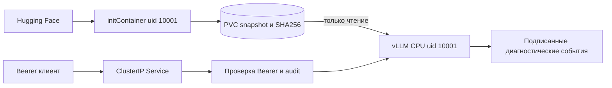

# CPU инференс vLLM в Kubernetes

Збиняков К.К. Команда исследования технологий машинного обучения.

OpenAI-совместимый API для `Qwen2.5-0.5B-Instruct`, vLLM `0.27.0+cpu`, только CPU. Проект включает основное задание и все бонусы: Kustomize, отдельный лёгкий initContainer и реальные нагрузочные измерения.

## Запуск

Нужны Docker с Linux-контейнерами, Python 3.12+ и kubectl. Проверенная машина: x86-64 с AVX2, Docker Desktop WSL2, 20 логических CPU и 15,44 ГиБ RAM. Для Docker рекомендуется 12 ГиБ RAM, 6 доступных CPU и 12 ГиБ свободного диска. Контейнер инференса ограничен 4 CPU / 7 ГиБ.

Из каталога проекта:

```powershell
python tools/local.py up
```

Скрипт использует только kind v0.33.0, собирает оба образа и создаёт случайный API-токен в Kubernetes Secret. Значение не попадает в аргументы команд; локальная копия находится в исключённом из Git `.secrets/api-token`. Первый запуск скачивает веса; следующий проверяет локальный snapshot, включая SHA-256 файлов.

В отдельном терминале:

```powershell
python tools/local.py forward
```

Затем:

```powershell
python tools/client.py "Explain what a Kubernetes initContainer does."
python tools/local.py verify
python tools/local.py status
```

Адрес API: `http://127.0.0.1:18000/v1/chat/completions`. Первый запрос после нового запуска может долго прогревать CPU-движок; клиент ждёт до 180 секунд. `health` подтверждает готовность сервера, а прогрев перед нагрузочным измерением выполняется отдельно.

Для удаления созданного кластера и его PVC выполните `python tools/local.py down`. Эта команда удаляет также скачанные в кластер веса. Остальные Docker-контейнеры и локальные файлы проекта она сохраняет.

## Карта требований

| Требование | Реализация | Проверка и доказательство |
|---|---|---|
| Kubernetes и vLLM >= 0.27 на CPU | `kind.yaml`, `Dockerfile`, `k8s/base/deployment.yaml` | [API-проверки](artifacts/verification.json): версия, CPU backend, CUDA отсутствует |
| Непривилегированный пользователь | UID/GID 10001, read-only rootfs, drop ALL, seccomp | Runtime UID и контексты безопасности в [окружении](artifacts/environment.json) |
| Все Python-зависимости закреплены | `requirements.txt`, `requirements-init.txt`, digest баз | `tools/check_lock.py` проверяет весь установленный набор; затем `pip check` |
| Приватные журналы и факт обращения | `app/privacy.py`, `app/logging.json`, `app/serve.py` | Подпись HMAC, строгая схема, sentinel-проверки обычного и потокового ответа |
| Веса на PVC и повторный запуск без HF | `app/download_model.py`, PVC, initContainer | [Offline-рестарт](artifacts/cache-verification.json), тесты восстановления и повреждения |
| HF-токен и Bearer-токен в Secret | `ml-research-secrets`, примеры в `k8s/base/secret.example.yaml` | Отсутствие и неправильный Bearer дают 401; HF-токен отсутствует в серверном контейнере |
| Настройки через ConfigMap | `k8s/base/configmap.yaml` | Профили экспериментов меняют настройки без пересборки |
| Бонус Kustomize | `k8s/kustomization.yaml` | `kubectl apply -k k8s`, [рендер](artifacts/rendered-manifests.yaml) |
| Бонус отдельный rootless initContainer | `Dockerfile.init`, `download-model` | Лёгкий образ без PyTorch/vLLM, UID 10001 |
| Бонус нагрузка и аналитика | `bench/run.py`, `bench/summarize.py`, `tools/run_experiments.py` | Сырые данные, повторы, TTFT, latency, throughput и контролируемые сравнения ниже |

Схема запуска:



## Проверки и воспроизводимость

```powershell
python -m unittest discover -s tests -v
python tools/local.py verify
```

Пройдено 56 unit-тестов в Linux под UID 10001, без сети и с read-only rootfs; пропусков нет. Результаты: [checks.json](artifacts/checks.json), [verification.json](artifacts/verification.json). Windows может пропустить создание symlink из-за прав; полный Linux-прогон покрывает и эту проверку.

Повторный запуск с запретом импорта HF SDK и создания Python-сокетов:

```powershell
python tools/verify_cache.py
```

После этой проверки нужно заново запустить port-forward. Она восстанавливает штатную команду initContainer даже при ошибке проверки. Маркер содержит ID модели, immutable commit SHA, размеры и SHA-256 файлов. При прерывании между переименованиями загрузчик восстанавливает подходящий staging или `.previous` до обращения к HF. Старые маркеры без хешей не принимаются: после обновления формата возможна одна повторная загрузка.

Приёмка из архива создаёт новый кластер с новым PVC, выполняет cold download и API-проверки, затем удаляет только этот временный кластер и возвращает рабочий Deployment:

```powershell
python tools/package.py
python tools/verify_cleanroom.py --archive "artifacts/Збиняков К.К. Команда исследования технологий машинного обучения.zip"
```

Доказательство: [cleanroom-verification.json](artifacts/cleanroom-verification.json). Оно содержит SHA-256 исходников проверенного архива; их можно сопоставить с исходниками сдаваемой версии. Локальный Docker layer cache при этой проверке сохраняется, а кластер и модельный PVC создаются заново.

Приёмка 29.10.2026 завершилась успешно: зафиксирована холодная загрузка, пройдены 17 API-проверок и offline-рестарт с неизменным маркером snapshot. Временный кластер удалён, рабочий Deployment восстановлен. Финальный архив дополнен этими доказательствами и документацией; SHA-256 исполняемых исходников совпадают с проверенной версией. Состояние рабочего сервиса после восстановления: [final-environment.json](artifacts/final-environment.json).

## Нагрузка

Базовый протокол: короткий и длинный вход, параллелизм 1/2/4, по 30 запросов в двух повторах на каждое сочетание, всего 360 измеряемых запросов. Перед каждым случаем прогревается полная волна с тем же параллелизмом. Ошибка любого прогревочного запроса отменяет измерение этого случая и даёт ненулевой код выхода.

```powershell
python tools/record_environment.py --output artifacts/environment.json
python tools/local.py benchmark --requests 30 --repeats 2 --label baseline --concurrency 1,2,4 --workload both --environment artifacts/environment.json --output bench/results.json
python bench/summarize.py bench/results.json --json bench/summary.json --markdown bench/summary.md
```

У всех запросов `temperature=0`, `max_tokens=32`, `ignore_eos=true`; число токенов берётся из server usage. TTFT заканчивается на первом непустом `delta.content`, latency на `[DONE]`. Throughput равен сумме успешных запросов или выходных токенов, делённой на суммарное измеряемое время. Прогрев в знаменатель не входит. Сырые записи сохраняют коды ошибок и тайминги, без токенов доступа, содержимого промптов и ответов.

Сводка объединяет токены и время повторов, а не усредняет их скорости. p50/p95 используют nearest rank по объединённым запросам; отдельно показан диапазон throughput повторов. Это локальный конечный closed-loop тест с kubectl port-forward, а не оценка production SLO. Рабочая станция общая, поэтому разброс остаётся существенной частью результата.

Фиксированные условия: `float32`, 4 OpenMP-потока, KV-кэш 1 ГиБ, контекст 2048, `max-num-seqs=4`, token budget 2048, chunked prefill включён. Prefix caching выключен через `no-enable-prefix-caching: true`: vLLM 0.27 пропускает обычное YAML-значение `false`. Фактические cache hits проверяются отдельно.

Измерено 29.10.2026, 16:30-16:52 МСК. Все 360 измеряемых запросов и все волны прогрева завершились успешно. Счётчики prefix-cache hits после серии равны нулю.

| Вход | Параллелизм | N | Req/s | Output tok/s (диапазон повторов) | TTFT p50 / p95, с | Latency p50 / p95, с |
|---|---:|---:|---:|---:|---:|---:|
| 46-47 токенов | 1 | 60 | 0.414 | 13.25 (13.13-13.37) | 0.207 / 0.265 | 2.378 / 2.589 |
| 46-47 токенов | 2 | 60 | 0.502 | 16.07 (16.02-16.13) | 0.287 / 0.448 | 3.915 / 4.115 |
| 46-47 токенов | 4 | 60 | 0.867 | 27.74 (27.53-27.96) | 0.619 / 0.706 | 4.316 / 4.418 |
| 1184-1185 токенов | 1 | 60 | 0.176 | 5.62 (5.59-5.65) | 3.394 / 3.679 | 5.613 / 6.075 |
| 1184-1185 токенов | 2 | 60 | 0.193 | 6.17 (6.11-6.23) | 3.782 / 7.038 | 10.306 / 10.975 |
| 1184-1185 токенов | 4 | 60 | 0.224 | 7.17 (7.10-7.25) | 6.873 / 13.078 | 17.404 / 20.652 |

При увеличении параллелизма с 1 до 4 throughput короткого входа вырос с 13,25 до 27,74 tok/s, длинного с 5,62 до 7,17 tok/s. У длинного входа p95 latency при этом выросла с 6,075 до 20,652 с. Пул из двух повторов даёт 60 измерений на строку; диапазон повторов показывает разброс скорости, но не является доверительным интервалом.

Сырые измерения: [results.json](bench/results.json); сводка: [summary.json](bench/summary.json); окружение: [environment.json](artifacts/environment.json). JSON содержит хеши исходников и файла окружения, зафиксированные до замера. Если Git HEAD существует, он тоже записывается.

## Контролируемые эксперименты

```powershell
python tools/run_experiments.py --requests 30 --repeats 2
$experimentFiles = (Get-ChildItem bench/experiments/repeat-*.json).FullName
python bench/summarize.py $experimentFiles --json bench/experiments/summary.json --markdown bench/experiments/summary.md
```

Скрипт использует собственный port-forward на 18001. В каждом сравнении сохраняет нагрузку и меняет только один параметр. Во втором повторе порядок условий обратный. После завершения или ошибки возвращает исходную ConfigMap; состояние восстановления попадает в [manifest.json](bench/experiments/manifest.json).

| Профиль | Одинаковая нагрузка | Единственное изменение |
|---|---|---|
| Поток коротких запросов | 46-47 входных токенов, параллелизм 8, 32 выходных токена | `max-num-seqs`: 4 -> 8 |
| Меньше длинных запросов | 1184-1185 входных токенов, параллелизм 2, 32 выходных токена | `max-num-batched-tokens`: 2048 -> 4096 |

На четыре условия приходится ещё 240 измеряемых запросов. Перед каждым случаем фиксируются конфигурация, образ, ресурсы и хеши; cache hits должны оставаться нулевыми. Размер модели, dtype, число потоков, KV-кэш и лимиты CPU/RAM одинаковы.

Измерено 29.10.2026, 16:55-17:32 МСК. Все 240 измеряемых запросов и волны прогрева успешны. Для каждого условия создан новый Pod; prefix-cache hits до и после измерения равны нулю. Исходная ConfigMap восстановлена.

| Условие | N | Output tok/s (диапазон повторов) | TTFT p50 / p95, с | Latency p50 / p95, с |
|---|---:|---:|---:|---:|
| Короткий, `max-num-seqs=4` | 60 | 28.38 (28.12-28.64) | 4.628 / 4.892 | 8.424 / 8.800 |
| Короткий, `max-num-seqs=8` | 60 | 47.86 (47.48-48.25) | 1.062 / 1.223 | 4.888 / 5.176 |
| Длинный, budget 2048 | 60 | 6.10 (5.92-6.29) | 3.765 / 6.868 | 10.287 / 11.998 |
| Длинный, budget 4096 | 60 | 6.00 (5.98-6.03) | 3.866 / 7.195 | 10.490 / 11.614 |

Для короткого входа при восьми одновременных клиентах лимит 8 увеличил pooled throughput на 68,7% и снизил p95 latency на 41,2%. Прирост throughput в отдельных повторах: +68,5% и +68,8%. На этом стенде это полезная настройка для потока коротких запросов: меньше клиентов ожидает свободной последовательности.

Для длинного входа устойчивого выигрыша от бюджета 4096 нет: изменение throughput составило -5,0% в первом повторе и +1,7% во втором; pooled-разница -1,6%. Такое изменение не обосновывает смену базового бюджета. По умолчанию оставлены 4 последовательности и 2048 токенов; профиль с 8 последовательностями имеет смысл выбирать под измеренную короткую нагрузку, а смешанную нагрузку проверять отдельно.

Сводка: [summary.json](bench/experiments/summary.json), [таблица](bench/experiments/summary.md). Все сырые серии и снимки окружения перечислены в [manifest.json](bench/experiments/manifest.json). [Проверка согласованности](artifacts/benchmark-verification.json) подтверждает 600 успешных измеряемых запросов в базовой и A/B-сериях, совпадение хешей и изменение одного параметра в каждой паре.

В случае большого потока коротких запросов `max-num-seqs` ограничивает количество одновременно декодируемых последовательностей. Для входов до 47 токенов существующего бюджета 2048 хватает на prefill восьми запросов; увеличивать оба параметра одновременно для этого сравнения не требуется. Разница в один токен возникает из-за номера запроса; набор номеров одинаков в каждой сравниваемой серии.

Для длинных входов token budget управляет работой prefill за итерацию. Более крупный бюджет может уменьшить количество частей входа, но занимает больше времени и памяти за шаг и способен ухудшить задержку уже идущего decode. Если нужен контекст больше 2048, отдельно увеличиваются `max-model-len` и KV-кэш в пределах модели и доступной памяти. Такая смена контекста в эксперимент выше не входит.

См. [CPU tuning vLLM 0.27](https://docs.vllm.ai/en/v0.27.0/getting_started/installation/cpu/) и [chunked prefill](https://docs.vllm.ai/en/v0.27.0/configuration/optimization/). Рост скорости не следует обещать до замера: в отчёте учитываются ошибки и диапазон повторов.

## Обоснование решений и сдача

Выбрана открытая [Qwen2.5-0.5B-Instruct](https://huggingface.co/Qwen/Qwen2.5-0.5B-Instruct), commit `7ae557604adf67be50417f59c2c2f167def9a775`. Небольшой размер позволяет проверить всю инфраструктуру на CPU. `float32` даёт проверенный на этой AVX2-машине вариант; сравнения с другими dtype или квантизацией не проводились, поэтому оптимальность такого выбора не заявляется.

Основной Dockerfile наследует официальный CPU-образ по digest и проверяет все 155 установленных Python-пакетов по `requirements.txt`. Он не запускает повторное разрешение зависимостей. InitContainer устанавливает 16 закреплённых пакетов с `--no-deps`, затем проверяет полный набор и `pip check`.

Приватность журналов обеспечивают отключение request/output logging, безопасный formatter и HMAC-проверка метаданных перед stdout/stderr. HMAC подтверждает происхождение события, не шифрует его. Диагностика сохраняет разрешённые компонент, этап и тип ошибки; текст исключения, произвольное имя logger и traceback исключены. Дополнительная проверка Bearer закрывает также маршруты, которые не защищает встроенный API-ключ vLLM; это ограничение описано в [документации безопасности](https://docs.vllm.ai/en/v0.27.0/usage/security/).

[Подробности эксплуатации](docs/OPERATIONS.md) содержат Kustomize, gated-модели, секреты, ограничения rootless и восстановление. [Подготовка к защите](docs/DEFENSE.md) объясняет принятые решения и короткий демо-сценарий.

`python tools/package.py` создаёт архив с именем «Збиняков К.К. Команда исследования технологий машинного обучения.zip». `.tools`, `.secrets`, Git, Python-кэши, веса и контейнерные слои в него не входят. Для сдачи остаётся создать репозиторий и передать ссылку в предусмотренном заданием формате.
